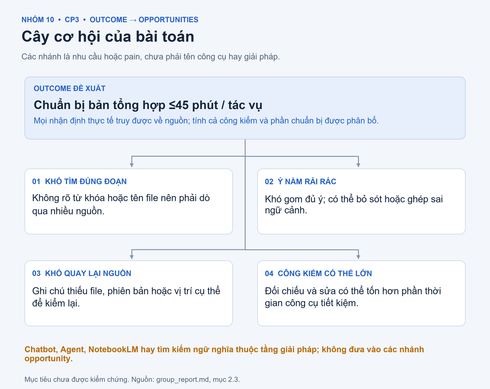
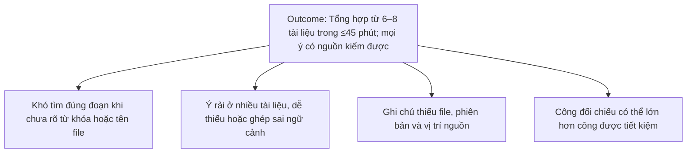
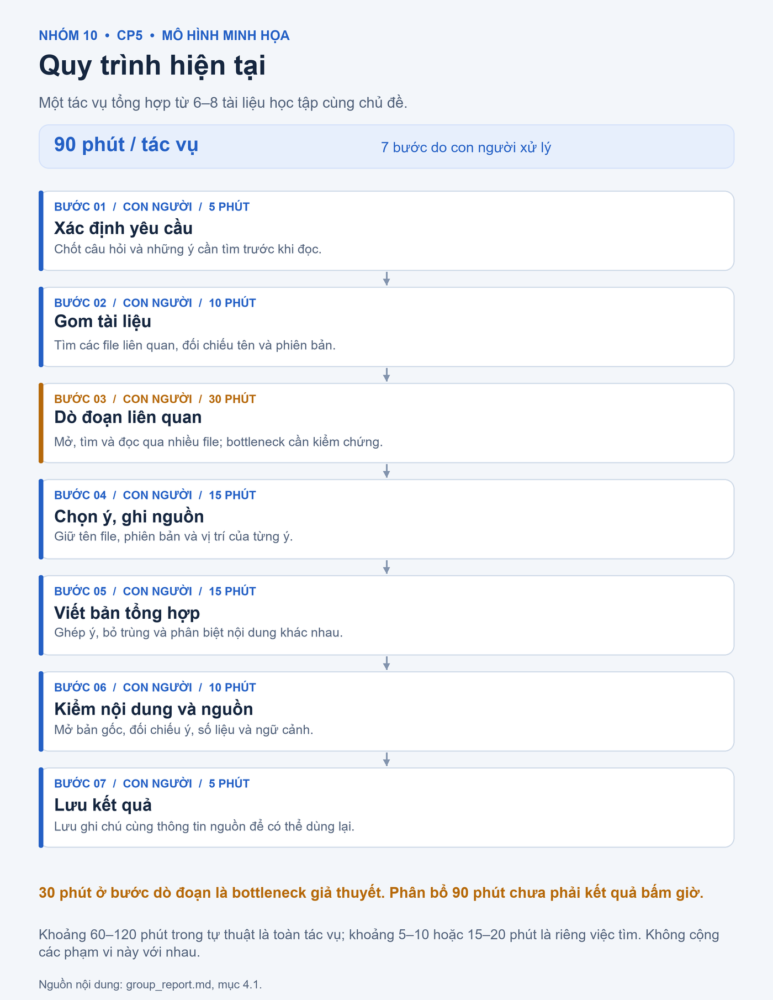
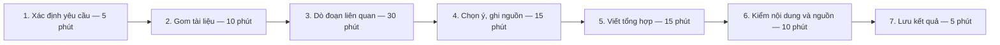
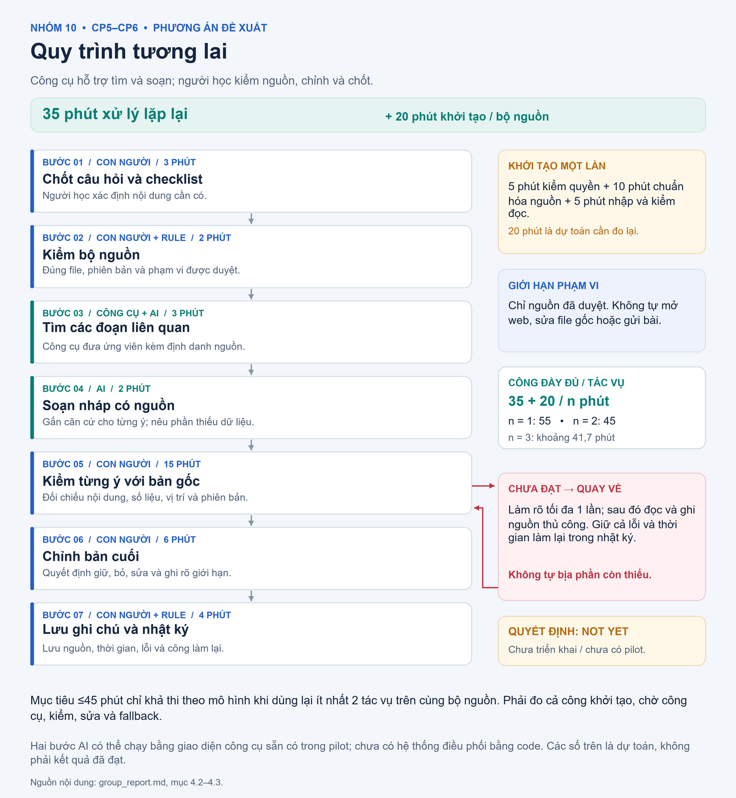
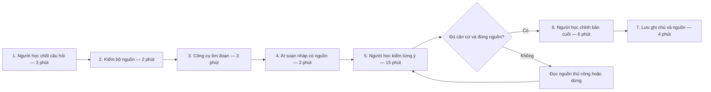

# Báo cáo nhóm 10 — Day 02 Discovery & Problem Framing

> **Phạm vi bản báo cáo:** tổng hợp đầy đủ CP3–CP6 từ 4 báo cáo cá nhân, có AI hỗ trợ phân tích và soạn thảo theo yêu cầu của người học. Bảng hội tụ là kết quả đối chiếu tài liệu, chưa phải biên bản một buổi pitch đã được xác nhận.
>
> **Quy ước bằng chứng:** “tự thuật” là thông tin thành viên ghi trong báo cáo; “ước lượng cá nhân” chưa phải số đo; “minh họa” là số dựng để phân tích; “mục tiêu” là kết quả mong muốn, chưa đạt được. Không có hồ sơ phỏng vấn/survey ngoài nhóm được cung cấp. Các bảng research dùng nguồn chính thức đã được mở kiểm tra ngày **09/11/2026**.

## 1. Thông tin nhóm

- **Tên nhóm:** Nhóm 10 — L3B.
- **Repo:** https://github.com/Duc1306/K5-L3B-Day02-Nhom10-DiscoveryProblemFraming
- **Candidate được chọn trong bản tổng hợp:** sinh viên mất nhiều thời gian tìm, đối chiếu và tổng hợp thông tin từ nhiều tài liệu học tập, đồng thời khó quay lại đúng đoạn nguồn để kiểm tra.
- **Job Story:** Khi cần chuẩn bị một bản tổng hợp từ nhiều tài liệu học tập, tôi muốn tìm đúng các ý liên quan và giữ được vị trí nguồn, để hoàn thành trong thời gian hợp lý mà vẫn kiểm tra lại được nội dung.
- **Phạm vi phân tích:** một chủ đề, 6–8 tài liệu được phép sử dụng; ưu tiên PDF có văn bản chọn được và Word có thể xuất PDF; có nhu cầu tra cứu lặp lại.
- **Mức can thiệp đề xuất:** **Workflow có AI hỗ trợ tìm đoạn và soạn nháp, con người kiểm nguồn**; chỉ xem xét dùng sau khi thử cách No AI/Rule.
- **Quyết định:** **Not Yet** cho triển khai giải pháp có AI. Thực hiện kiểm chứng và so sánh trước, chưa xây ứng dụng hoặc Agent.

### 1.1. Bốn nguồn đầu vào

| Thành viên | MSSV | Báo cáo cá nhân | Phần nổi bật dùng để tổng hợp |
|---|---|---|---|
| Trịnh Minh Đức | 2A202604078 | [Báo cáo Minh Đức](../individual/2A202604078_TrinhMinhDuc.md) | Chi tiêu cá nhân, chia tiền chung, mua thiếu đồ; phân biệt trải nghiệm đã kể với số liệu mô phỏng. |
| Trương Anh Đức | 2A202604096 | [Báo cáo Anh Đức](../individual/2A202604096_TruongAnhDuc.md) | Kiểm nguyên liệu, lập danh sách đi chợ, chốt lịch; chú ý nguyên nhân thật của chuyến đi phát sinh. |
| Vũ Ngọc Tùng | 2A202604106 | [Báo cáo Tùng](../individual/2A202604106_VuNgocTung.md) | Tìm thông tin Word/PDF, tổng hợp và giữ nguồn; có tình huống dẫn sai đường dẫn, phải kiểm tra lại. |
| Nguyễn Trọng Khiêm | 2A202604109 | [Báo cáo Khiêm](../individual/2A202604109_NguyenTrongKhiem.md) | Tổng hợp báo cáo nhóm, ôn tập từ 6–8 tài liệu, quản lý deadline; có ước lượng tổng thời gian theo trải nghiệm. |

Có **31 dòng scan CP1**: Minh Đức 10, Anh Đức 8, Tùng 8, Khiêm 5; mỗi người có 3 card CP2, tổng cộng **12 card**. Các dòng trùng hoặc là bước của cùng quy trình được gom lại, không xem là 31 vấn đề độc lập.

**Lưu ý bối cảnh:** nhóm bài tập 5 người được Khiêm nhắc đến là trải nghiệm trong báo cáo cá nhân; Nhóm 10 ở bài lab này gồm 4 thành viên nêu trên. Khai báo đóng góp cá nhân được quản lý riêng trong [TEAM.md](../../TEAM.md); bảng nguồn ở đây không thay cho xác nhận ai đã thực hiện hoạt động nhóm.

---

## 2. Hội tụ nhóm (CP3)

### 2.1. Tổng hợp 12 card để chuẩn bị pitch

Cột cuối là câu hỏi phản biện được đề xuất khi đọc tài liệu, **không gán thành lời phát biểu của một thành viên**. Các file chưa có nhật ký pitch và người đặt câu hỏi thực tế.

| Mã | Nguồn card | Candidate / Job Story ngắn | Actor | Bottleneck và mức bằng chứng | Câu hỏi phản biện đề xuất |
|---|---|---|---|---|---|
| M1 | Minh Đức #1 | Khi cuối tháng tiền gần hết, biết tiền đã đi đâu để điều chỉnh tháng sau. | Người tự quản lý chi tiêu. | Đối chiếu, phân loại 20 phút; tổng 60 phút/tháng là minh họa. Tình huống gần hết tiền đã được kể. | Biết nhóm chi có giúp giảm chi vượt dự định, hay khó khăn nằm ở thói quen mua? |
| M2 | Minh Đức #2 | Khi đi ăn/đi chơi chung, chốt đúng phần tiền từng người. | Người ứng tiền và người tham gia. | Xác nhận cách chia 7 phút, tổng 25 phút là minh họa. | Tính tiền hay chờ xác nhận mới gây chậm? Công thức cố định đã đủ chưa? |
| M3 | Minh Đức #3 | Khi mua đồ, biết món còn/thiếu để tránh mua trùng và đi lại. | Người mua đồ sinh hoạt. | Quay lại mua thêm 15 phút; bình quân 42,5 phút/lần mua là mô hình. | Chuyến quay lại có do quên món đã biết trước, hay nhu cầu mới phát sinh? |
| A1 | Anh Đức #1 | Khi chuẩn bị bữa tối, biết nguyên liệu đang có để không mua trùng. | Người nấu/đi chợ. | Nhớ và đối chiếu nguyên liệu; thời gian chưa đo; tần suất mua trùng là ước lượng. | Kiểm tủ và danh sách đánh dấu có xử lý được không? |
| A2 | Anh Đức #2 | Khi mua cho vài ngày, gom đủ nhu cầu để không quay lại cửa hàng. | Người lập danh sách và người mua. | Chuyến quay lại khoảng 20 phút đi xe theo ước lượng; thời gian lập danh sách chưa đo. | Bao nhiêu chuyến do thiếu danh sách, bao nhiêu do hết hàng hoặc đổi ý? |
| A3 | Anh Đức #3 | Khi nhiều người hẹn gặp, tìm khung giờ chung để chốt lịch. | Người tổ chức và người được mời. | Lần gần nhất kéo dài vài ngày; chưa tách thời gian xử lý và chờ. | Bình chọn 2–3 khung giờ cùng hạn trả lời có đủ không? |
| T1 | Tùng #1 | Khi tra cứu Word/PDF, tìm và tổng hợp đúng thông tin có nguồn. | Người học tra cứu tài liệu. | Tìm khoảng 5–10 phút ở trường hợp dễ, 15–20 phút ở trường hợp khó; ước lượng cá nhân. | Tìm kiếm từ khóa và đặt tên file tốt hơn đã giảm đủ thời gian chưa? |
| T2 | Tùng #2 | Khi thông tin rải rác, khoanh vùng đúng file và đoạn cần đọc. | Người học tra cứu. | Dò đoạn liên quan; chưa có số đo riêng. | Đây là problem riêng hay bước tìm kiếm thuộc T1? |
| T3 | Tùng #3 | Khi ghép ý từ nhiều tài liệu, giữ đường dẫn về nguồn để kiểm tra. | Người học tổng hợp. | Chưa đo riêng bước tổng hợp; CP1 có sự cố dẫn sai nguồn và mất thêm khoảng 15 phút kiểm tra. | Nguồn có thật sự chứng minh ý viết ra, hay chỉ đúng tên file? |
| K1 | Khiêm #1 | Khi nhận bài từng người, ghép thành báo cáo thống nhất. | Người tổng hợp báo cáo. | Tổng 60–120 phút theo tự thuật; rà trùng/thiếu 25 phút chỉ là phân bổ AI minh họa. | Một tài liệu chung, mẫu thống nhất và checklist có đủ chưa? |
| K2 | Khiêm #2 | Khi ôn kiểm tra, tìm và gom trọng tâm từ nhiều tài liệu. | Sinh viên ôn tập. | 6–8 tài liệu, khoảng 60–120 phút chuẩn bị theo tự thuật; chọn ý 30 phút là minh họa. | Chậm vì tìm/tổng hợp hay vì chưa hiểu kiến thức? Đo hai việc đó riêng thế nào? |
| K3 | Khiêm #3 | Khi học nhiều môn, biết đầy đủ deadline và yêu cầu nộp. | Sinh viên theo dõi 5–6 môn. | Khoảng 15–20 phút/tuần theo tự thuật; tìm thông báo 7 phút là minh họa. | Bảng deadline và nhắc lịch có sẵn đã đủ chưa? Biết tin muộn có thực sự dẫn đến nộp muộn không? |

Trong báo cáo Tùng, bảng xếp hạng và phần card diễn đạt các khía cạnh hơi khác nhau. Bản nhóm dùng **nội dung card chi tiết**, rồi gom T1–T3 thành cùng một hướng; không tính ba card này là ba bằng chứng độc lập.

### 2.2. Cluster

| Cluster | Các card / nguồn liên quan | Pattern chung | Cách xử lý |
|---|---|---|---|
| A — Tìm và tổng hợp tài liệu có nguồn | T1, T2, T3, K2; tình huống tìm tài liệu ở CP1 của Minh Đức là minh họa bổ sung. | Thông tin nằm rải rác; tìm ý, tổng hợp và quay lại nguồn mất công. | Gộp thành một candidate, giữ riêng phép đo tìm đoạn và chuẩn bị bản tổng hợp. |
| B — Tổng hợp báo cáo nhóm | K1. | Nhận nhiều phần bài, xử lý định dạng, trùng và thiếu. | Vào shortlist; phải thử mẫu chung trước. |
| C — Nhìn lại chi tiêu cá nhân | M1 và CP1 #5 của Khiêm. | Nhận ra tiền ít hơn dự định khi đã gần cuối tháng. | Vào shortlist; số tài chính minh họa không trở thành baseline chung. |
| D — Chuẩn bị mua đồ | M3, A1, A2. | Không biết rõ đồ còn/thiếu, thiếu phối hợp hoặc danh sách chưa đầy đủ. | Hướng dự phòng; thử No AI/Rule trước. |
| E — Chốt lịch nhiều người | A3 và CP1 #4 của Khiêm. | Câu trả lời rải rác và thời gian chờ kéo dài. | Giữ cho vòng sau; chưa rõ tác động chủ động so với thời gian chờ. |
| F — Theo dõi deadline | K3. | Thông báo ở nhiều kênh, dễ trôi hoặc cập nhật muộn. | Ưu tiên bảng tập trung và nhắc lịch có sẵn. |
| G — Chia khoản chi chung | M2. | Dữ liệu người tham gia/khoản ứng chưa thống nhất. | Rule phù hợp; hiện chủ yếu có ví dụ giả định. |

### 2.3. Opportunity Solution Tree rút gọn

**Outcome đề xuất** của nhánh được chọn: chuẩn bị một bản tổng hợp từ 6–8 tài liệu trong tối đa 45 phút/tác vụ, tính cả công kiểm nguồn và phần chuẩn bị được phân bổ; mọi ý thực tế đều truy được về nguồn.

[Bản SVG](../assets/cp3-opportunity-tree.svg) · [Nguồn Mermaid](../assets/cp3-opportunity-tree.mmd)

Xem sơ đồ Mermaid có thể chỉnh sửa

Các ý được loại khỏi tầng opportunity vì là **solution**:

- “Xây chatbot hỏi đáp tài liệu.”
- “Làm Agent tự đọc mọi tài liệu rồi tự trả lời.”
- “Dùng NotebookLM” hoặc “dùng Zotero.”
- “Tạo kho tìm kiếm ngữ nghĩa.”

Những hướng này chỉ được xét sau khi hiểu pain và so sánh cách đơn giản hơn.

### 2.4. Chấm điểm shortlist (1–5)

Điểm là đánh giá phân tích trong bản tổng hợp, không phải kết quả bỏ phiếu đã diễn ra. Mỗi tiêu chí có trọng số bằng nhau; “pain có bằng chứng” đánh giá chất lượng nguồn hiện có, không dùng số minh họa để tăng điểm.

| Candidate | Actor rõ | Quy trình rõ | Pain có bằng chứng | Impact đo được | Vừa sức lab | So sánh được 4 mức | Nhóm hiểu domain | Tổng |
|---|---:|---:|---:|---:|---:|---:|---:|---:|
| A — Tìm và tổng hợp tài liệu có nguồn | 5 | 4 | 4 | 4 | 5 | 5 | 5 | **32/35** |
| B — Tổng hợp báo cáo nhóm | 5 | 5 | 3 | 4 | 5 | 4 | 5 | **31/35** |
| C — Nhìn lại chi tiêu cá nhân | 5 | 4 | 3 | 4 | 4 | 4 | 5 | **29/35** |

**Lý do chấm:**

- **A:** có hai bối cảnh tự thuật bổ trợ nhau: Tùng tìm thông tin/kiểm nguồn, Khiêm chuẩn bị tài liệu ôn tập. Tuy nhiên chưa có đo chung hoặc người ngoài nhóm, nên bằng chứng chưa đạt mức 5.
- **B:** có quy trình và mức 60–120 phút rõ trong một báo cáo; khả năng giải bằng mẫu chung rất đáng thử. Còn thiếu bằng chứng về mức độ lặp ở người khác và bước nghẽn thật.
- **C:** có trải nghiệm chi tiêu từ Minh Đức và Khiêm, nhưng các mức tiền, tỷ lệ vượt và 60 phút trong mô hình Minh Đức không phải số đo. Cần thời gian theo dõi hành vi dài hơn một tác vụ tra cứu.

**Candidate được chọn:** A — tìm và tổng hợp thông tin học tập có nguồn kiểm chứng.

**Vì sao chọn:** kết hợp được nhu cầu tìm đúng thông tin, gom ý và kiểm nguồn; có thể thiết kế tác vụ so sánh nhỏ; đo được cả thời gian và chất lượng. Phạm vi một chủ đề và một bộ tài liệu giúp tránh trượt thành một hệ thống tra cứu mọi thứ.

**Vì sao không chọn các hướng khác trong vòng này:**

1. **Tổng hợp báo cáo nhóm:** mẫu chung và làm trực tiếp trên một tài liệu có thể đã giải được phần lớn việc ghép/format; cần thử cách này trước khi chứng minh cần AI.
2. **Chi tiêu cá nhân:** tăng độ rõ thông tin chưa chắc thay đổi hành vi mua; cần dữ liệu nhiều tuần và theo dõi việc nhập, không phù hợp nhất để xác nhận nhanh trong vòng này.
3. **Đi chợ:** nên thử kiểm đồ và danh sách trước; các ước lượng “mỗi lần” và nguyên nhân chuyến đi thêm chưa được kiểm.
4. **Chốt lịch, deadline, chia tiền:** bình chọn, lịch nhắc và công thức cố định là đối chứng mạnh; hiện thiếu bằng chứng mức đó không đủ.

**Xử lý bất đồng:** chưa có nguồn ghi nhận một bất đồng đã diễn ra, nên không dựng chuyện thành viên bỏ phiếu hoặc đổi ý. Nếu nhóm chọn khác bảng điểm, ghi rõ bằng chứng mới, tác động và lý do thay đổi; ưu tiên giải pháp đơn giản đủ dùng.

---

## 3. Kiểm chứng + research giải pháp đã có (CP4)

### 3.1. Assumption Map

Thang “đã có bằng chứng”: 1 = chưa có dữ liệu phù hợp; 5 = có nhiều quan sát trực tiếp và phép đo nhất quán. Điểm cao ở cột quan trọng nhưng thấp ở cột bằng chứng được kiểm trước.

| # | Giả định | Loại | Quan trọng | Đã có bằng chứng | Cách kiểm trước |
|---:|---|---|---:|---:|---|
| 1 | Người ngoài nhóm cũng gặp khó khăn tìm/tổng hợp, không chỉ một người có cách lưu file chưa phù hợp. | Value | 5 | 2 | Phỏng vấn 2–3 người ngoài nhóm về lần làm gần nhất, xem dấu vết tác vụ nếu họ đồng ý. |
| 2 | Sau khi đặt tên, tìm từ khóa, dùng bookmark và ghi nguồn, vẫn còn công tổng hợp đáng giải quyết. | Value | 5 | 1 | Đo đối chứng No AI đã cải thiện trước khi dùng AI; nếu đủ thì dừng ở mức đó. |
| 3 | Bộ tài liệu có thể đọc được, xác định được phiên bản và được phép dùng trong phép thử. | Feasibility / Viability | 5 | 2 | Kiểm 6–8 file thực tế; loại tài liệu không có quyền dùng, ảnh quét chưa đọc được hoặc thiếu bản gốc. |
| 4 | Bản nháp có citation thực sự đúng nội dung, số liệu và vị trí nguồn. | Feasibility | 5 | 1 | Chấm bộ eval ở mục 7.4 và kiểm từng nhận định với tài liệu gốc. |
| 5 | Tổng công kiểm và sửa giảm, kể cả chuẩn bị bộ nguồn; người dùng kiểm được trong khoảng 15 phút/tác vụ. | Usability | 5 | 1 | Bấm giờ đầy đủ, ghi công làm lại và phần chuẩn bị; không chỉ đo thời gian AI trả lời. |
| 6 | Người dùng chấp nhận cách thao tác và việc đưa tài liệu được phép lên công cụ, với hạn mức sẵn có. | Viability | 5 | 1 | Kiểm quyền, tài khoản và giới hạn thực tế trước; chọn phương án cục bộ khi không đáp ứng. |

**Ưu tiên:** giả định #2, #4 và #5 quyết định có cần bước AI và có thật sự tiết kiệm công hay không. #1 và #3 là điều kiện để chọn đúng người và dữ liệu cho thử nghiệm.

### 3.2. Bằng chứng hiện có và kế hoạch kiểm chứng

Tài liệu phụ: [hướng dẫn hỏi](../assets/cp4-interview-guide.md), [mẫu snapshot](../assets/cp4-interview-snapshot-template.md), [ghi chú nội bộ](../assets/cp4-interview-notes-internal.md), [mẫu survey](../assets/cp4-survey-form.md) và [CSV phản hồi trống](../assets/cp4-survey-responses-template.csv). Chưa có ảnh kết quả survey hoặc phỏng vấn ngoài nhóm.

#### 3.2.1. Sổ bằng chứng

| Mã | Nguồn, cách thu thập | Điều được ghi nhận | Giới hạn / tín hiệu phản bác |
|---|---|---|---|
| E1 | [Tùng, CP1 #1 và Card #1](../individual/2A202604106_VuNgocTung.md); đọc báo cáo cá nhân trong lần tổng hợp này. | Tìm khoảng 5–10 phút khi ít file/tên rõ; 15–20 phút khi nhiều file/tên khó nhận biết. | Ước lượng tự thuật, chưa bấm giờ; trường hợp dễ có thể không cần AI. |
| E2 | [Tùng, CP1 #4](../individual/2A202604106_VuNgocTung.md). | Từng dẫn sai đường dẫn do tệp tên giống nhau, mất thêm khoảng 15 phút kiểm tra khi làm đồ án. | Một sự cố đã kể, chưa có tần suất hoặc ảnh/log; không khẳng định lỗi xảy ra thường xuyên. |
| E3 | [Khiêm, CP1 #2 và Card #2](../individual/2A202604109_NguyenTrongKhiem.md). | Lần ôn gần nhất phải xem 6–8 tài liệu; khoảng 60–120 phút tìm, chọn lọc và tổng hợp. | Chưa tách công tìm, hiểu kiến thức và tổng hợp; không cộng khoảng này với E1 để tạo baseline. |
| E4 | [Tùng, CP1 #7](../individual/2A202604106_VuNgocTung.md); lời kể gián tiếp về một tester. | Khó tra cứu tài liệu thiết kế rải rác khi viết test case. | Chưa có hồ sơ hỏi, thời điểm hoặc số đo; bối cảnh công việc khác học tập, không tính là interview CP4 hoàn chỉnh. |
| E5 | [Khiêm, phương án không dùng AI ở Card #2](../individual/2A202604109_NguyenTrongKhiem.md) và research mục 3.3. | Có cách tổ chức thư mục, dàn ý, ghi nguồn và tìm văn bản cần được thử trước. | Chưa có bằng chứng các cách đơn giản thất bại; đây là phản bác với việc mặc định cần AI. |

**Số hồ sơ được cung cấp:** 4 báo cáo cá nhân; 2 báo cáo có tự thuật trực tiếp liên quan hướng đã chọn; **0 interview snapshot hoàn chỉnh với người ngoài nhóm**, **0 bộ survey**. Hai thành viên trong nhóm không được tính thành hai người phỏng vấn ngoài nhóm; E4 cũng không thay thế một snapshot.

#### 3.2.2. Snapshot tự thuật nội bộ — không phải phỏng vấn ngoài nhóm

| Trường | Trường hợp tra cứu Word/PDF | Trường hợp chuẩn bị ôn tập |
|---|---|---|
| Vai trò | Người học từng tra cứu tài liệu và làm đồ án. | Sinh viên chuẩn bị tài liệu trước kiểm tra. |
| Nguồn | Báo cáo Tùng, CP1 #1, #4, #5. | Báo cáo Khiêm, CP1 #2. |
| Trích nguyên văn từ báo cáo | “mất 15–20 phút khi có nhiều tài liệu, tên tệp khó nhận biết hoặc thông tin nằm rải rác” | “Tôi mất khoảng 1–2 giờ để tìm kiếm, chọn lọc và tổng hợp những nội dung cần ôn.” |
| Chuyện đã kể | Từng dẫn sai đường dẫn do các tệp tên giống nhau; có tài liệu dài 50–70 trang cần dò. | Lần ôn gần nhất xem khoảng 6–8 slide/PDF và ghi chép để tìm nội dung cần ôn. |
| Cách làm hiện tại | Mở file, tìm/đọc đoạn, ghi nội dung rồi đối chiếu nguồn; chưa có log thống nhất. | Xem lại slide, tài liệu, ghi chép rồi chọn lọc và tổng hợp. |
| Thời gian / tần suất | Khoảng tìm 5–10 hoặc 15–20 phút; lỗi nguồn phát sinh thêm khoảng 15 phút; tần suất chưa rõ. | Khoảng 60–120 phút/lần được kể; tần suất chưa rõ. |
| Insight | Phải giữ cả nội dung lẫn định danh file, phiên bản và vị trí. | Cần tách thời gian chuẩn bị tài liệu khỏi thời gian thực sự học và làm bài. |

Thời điểm xảy ra và bằng chứng tác vụ chưa có trong nguồn. Việc đọc báo cáo diễn ra khi tổng hợp bài; không tự gán đó là ngày phỏng vấn.

#### 3.2.3. Kế hoạch hỏi 2–3 người ngoài nhóm theo The Mom Test

Chọn sinh viên thực sự vừa tìm/tổng hợp nhiều tài liệu; không chọn thành viên Nhóm 10. Chỉ lưu vai trò, thời điểm hỏi, cách hỏi và dữ liệu đã được đồng ý dùng.

1. Lần gần nhất bạn phải tìm thông tin từ nhiều tài liệu là khi nào? Bạn cần tạo đầu ra gì?
2. Bạn đã mở những file hoặc nơi lưu nào, theo thứ tự ra sao?
3. Đoạn nào bạn tìm lâu nhất? Có thể kể lại hoặc xem dấu thời gian không?
4. Bạn đã thử tìm từ khóa, bookmark, ghi chú hoặc đổi cách lưu file thế nào?
5. Có lần nào lấy nhầm bản hoặc không tìm lại được nguồn? Chuyện đó dẫn đến việc gì?
6. Lần đó bạn mất bao lâu để tìm, đọc, tổng hợp và kiểm lại? Phần nào là chờ?
7. Bạn có thể cho xem một tác vụ và bộ tài liệu không nhạy cảm để đo lại không?

Mỗi buổi ghi snapshot riêng với lời nói nguyên văn, hành vi, workaround, thời gian, tín hiệu phản bác và nguồn. Nếu người được hỏi chỉ mất 5 phút hoặc mẫu ghi nguồn đã đủ, ghi nhận điều đó để thu hẹp actor.

#### 3.2.4. Điều chỉnh problem sau đối chiếu tài liệu và research

| Trước khi phân tích sâu | Điều chỉnh trong bản tổng hợp | Căn cứ |
|---|---|---|
| Tìm nhanh mọi thông tin trong mọi tài liệu. | Giới hạn một chủ đề, 6–8 tài liệu học tập đọc được, được phép sử dụng và có nhu cầu dùng lại. | E1 có trường hợp dễ chỉ mất 5–10 phút; E3 là bối cảnh cụ thể hơn. |
| Chỉ cần câu trả lời nhanh. | Cần từng ý có nguồn kiểm được và không ghép sai ngữ cảnh. | E2 có sự cố dẫn sai nguồn. |
| Gộp tốc độ tìm với chất lượng học. | Tách thời gian tìm, tổng hợp, kiểm nguồn; không hứa cải thiện điểm số. | E3 chưa tách khó tìm và khó hiểu bài. |
| Mặc định dùng AI. | Thử No AI/Rule trước; AI chỉ tiếp tục nếu tạo lợi ích tăng thêm sau khi tính công kiểm. | E5 và các nguồn chính thức ở mục 3.3. |

Đây là thay đổi sau **đối chiếu bằng chứng trong file và research**, không phải kết quả một vòng phỏng vấn ngoài nhóm đã hoàn tất.

### 3.3. Research giải pháp đã có

[Bản ghi chú research lưu trong assets](../assets/cp4-research-notes.md).

Các link dưới đây đã được mở kiểm tra ngày 09/11/2026. Nội dung “bài học” là suy luận thiết kế của bản báo cáo; tính năng công cụ không chứng minh giải pháp sẽ đạt metric của nhóm.

| Công cụ / pattern | Nguồn chính thức | Giải bước nào? | Điểm mạnh đã kiểm từ tài liệu | Khoảng trống / bài học cho nhóm |
|---|---|---|---|---|
| Adobe Acrobat — tìm văn bản trong nhiều PDF | [Searching in PDFs](https://helpx.adobe.com/acrobat/using/searching-pdfs.html) | Dò đoạn trong một file hoặc một thư mục PDF. | Hướng dẫn có tìm từ/cụm từ, tìm nhiều PDF ở một vị trí và xem kết quả theo tài liệu. | Là đối chứng tìm kiếm thông thường. Việc hiểu ý và tổng hợp vẫn cần kiểm; phải thử trên bản cài và file thực tế, không suy ra mọi tệp đều tìm được. |
| Zotero — annotation và ghi chú giữ nguồn | [PDF Reader and Note Editor](https://www.zotero.org/support/pdf_reader) | Lưu đoạn đã chọn, gom ghi chú và quay lại nguồn. | Ghi chú tạo từ annotation có liên kết về trang PDF và citation; có thể mở đoạn trong ngữ cảnh. | Là đối chứng No AI cho việc giữ nguồn. Người dùng vẫn tự chọn/đối chiếu ý; đáng thử trước khi thêm bước AI. |
| NotebookLM — trang hỗ trợ hiện hiển thị tên Gemini Notebook | [Nguồn được hỗ trợ](https://support.google.com/gemininotebook/answer/16215270?hl=en), [Chat và citation](https://support.google.com/gemininotebook/answer/16179559?hl=en) | Hỏi trên bộ nguồn đã chọn, tìm ý và hỗ trợ soạn nháp. | Tài liệu nêu hỗ trợ PDF/DOCX; câu trả lời có citation để mở nội dung nguồn và xem ngữ cảnh. | Có thể dùng để thử bước AI có sẵn. Citation vẫn phải kiểm nội dung; chỉ xét bộ nguồn được duyệt, không đưa tính năng nghiên cứu web/tự hành vào phạm vi thử. |

**Kết luận research:** không có căn cứ cần tự xây kho tra cứu hoặc Agent. Phép thử nên dùng công cụ sẵn có và so sánh ba cách: cách hiện tại; cách tổ chức/tìm/ghi nguồn tốt hơn mà không dùng AI; cách có AI soạn nháp nhưng người kiểm nguồn. Năng lực thực tế, chi phí và quyền tài khoản sẽ được kiểm trước pilot, không giả định mọi gói giống nhau.

---

## 4. Quy trình trước/sau (CP5)

### 4.1. Quy trình hiện tại

**Đơn vị so sánh:** một lần chuẩn bị bản tổng hợp cho một chủ đề từ 6–8 tài liệu tương đương, không tính thời gian học thuộc hoặc luyện bài. Khoảng 60–120 phút của Khiêm là tự thuật về một tác vụ; khoảng 5–10/15–20 phút của Tùng là riêng việc tìm. Hai phạm vi này không được cộng hoặc lấy trung bình với nhau.

Bảng dưới dùng **mô hình 90 phút** nằm trong khoảng tự thuật của Khiêm để thiết kế phép đo. Phân bổ từng bước và bottleneck 30 phút là giả thuyết, chưa phải baseline đã đo của cả nhóm.

[Bản SVG](../assets/cp5-workflow-current.svg) · [Nguồn Mermaid](../assets/cp5-workflow-current.mmd)

Xem sơ đồ Mermaid có thể chỉnh sửa

| Bước | Actor | Input | Output / bàn giao | Thời gian mô hình | Ghi chú |
|---:|---|---|---|---:|---|
| 1 | Người học | Yêu cầu hoặc chủ đề cần chuẩn bị. | Danh sách câu hỏi/ý cần tìm. | 5 phút | Chốt phạm vi, không đọc mọi tài liệu mà chưa biết cần gì. |
| 2 | Người học | File ở thư mục hoặc nơi lưu được phép dùng. | Danh sách tài liệu có thể liên quan. | 10 phút | Có thể gặp tên giống nhau hoặc nhiều phiên bản. |
| 3 | Người học | Danh sách file, từ khóa và câu hỏi. | Các đoạn có vẻ liên quan. | 30 phút | **Bottleneck giả thuyết:** mở, tìm và đọc qua nhiều file. |
| 4 | Người học | Các đoạn đã tìm. | Ghi chú ý chính và vị trí nguồn. | 15 phút | Nếu không ghi vị trí ngay, bước kiểm lại có thể kéo dài. |
| 5 | Người học | Ghi chú từ nhiều nguồn. | Bản tổng hợp nháp. | 15 phút | Loại ý trùng, phân biệt các ý khác nhau. |
| 6 | Người học | Bản nháp và tài liệu gốc. | Bản đã kiểm thông tin, số liệu, nguồn. | 10 phút | Không coi việc có đường dẫn là đã đúng nội dung. |
| 7 | Người học | Bản đã kiểm. | Bản ghi chú có thể mở và dùng lại. | 5 phút | Lưu cùng thông tin bộ nguồn. |
| **Tổng** | | | | **90 phút/tác vụ** | **5 + 10 + 30 + 15 + 15 + 10 + 5.** |

**Bottleneck chính cần kiểm:** bước 3 dò đoạn liên quan. Nếu đo thực tế cho thấy hiểu kiến thức hoặc kiểm nguồn mới tốn nhất, phải sửa problem và hướng can thiệp; không giữ mô hình 30 phút để khớp ý tưởng ban đầu.

### 4.2. Quy trình tương lai

#### 4.2.1. Chuẩn bị bộ nguồn một lần

Dự toán **20 phút/bộ nguồn**: kiểm quyền và phạm vi 5 phút; chuẩn hóa tên/phiên bản, xuất Word sang PDF khi cần và lập danh mục 10 phút; nhập và kiểm khả năng đọc 5 phút. Số này cần đo lại; file lỗi hoặc chuyển đổi lâu được tính vào công thật.

Mỗi nguồn có mã riêng, tên file, phiên bản được người học chọn, vị trí lưu và trạng thái được phép sử dụng. Dùng số trang PDF hoặc tiêu đề/mục rõ ràng để đối chiếu; không suy đoán trang Word tương ứng trang PDF nếu chưa kiểm.

**Phạm vi pilot:** tài liệu học tập không nhạy cảm, người dùng có quyền dùng. Không đưa tài liệu nội bộ của tester được kể ở CP1 vào phép thử. File ảnh quét chưa đọc được, bản mất nguồn hoặc không xác định quyền nằm ngoài phạm vi đầu tiên.

#### 4.2.2. Xử lý một tác vụ trên bộ nguồn đã chuẩn bị

[Bản SVG](../assets/cp5-workflow-future.svg) · [Nguồn Mermaid](../assets/cp5-workflow-future.mmd)

Xem sơ đồ Mermaid có thể chỉnh sửa

| Bước | Mức xử lý | Input | Output | Dự toán / tác vụ | Người chịu trách nhiệm |
|---:|---|---|---|---:|---|
| 1 | Con người | Yêu cầu, danh sách ý cần có. | Câu hỏi và checklist đã chốt. | 3 phút | Người học quyết định phạm vi. |
| 2 | Con người + Rule | Danh mục nguồn được duyệt. | Bộ file và phiên bản đúng cho tác vụ. | 2 phút | Người học kiểm quyền, công cụ đối chiếu mã/phiên bản. |
| 3 | Công cụ + AI hỗ trợ tìm ý | Câu hỏi và bộ nguồn đã chọn. | Các đoạn liên quan kèm định danh nguồn. | 3 phút | Công cụ đưa ứng viên; chưa coi là kết luận đúng. |
| 4 | AI | Các đoạn tìm được và định dạng yêu cầu. | Bản nháp, nguồn cho từng ý, phần chưa đủ thông tin. | 2 phút | AI chỉ soạn trong phạm vi đầu vào. |
| 5 | Con người — điểm kiểm tra bắt buộc | Bản nháp và nguồn gốc. | Đánh dấu ý đúng, thiếu, sai hoặc không có căn cứ. | 15 phút | Người học mở nguồn, người kiểm độc lập chấm ở pilot. |
| 6 | Con người | Bản đã đối chiếu. | Bản cuối đã sửa và ghi rõ giới hạn. | 6 phút | Người học quyết định giữ/bỏ; không giao AI tự chốt. |
| 7 | Con người + Rule | Bản cuối và danh mục nguồn. | Ghi chú, liên kết nguồn, nhật ký thời gian/lỗi. | 4 phút | Người học lưu và kiểm mở lại được. |
| **Tổng lặp lại** | | | | **35 phút** | **3 + 2 + 3 + 2 + 15 + 6 + 4.** |

Dự toán tính cả chờ công cụ trong bước 3–4. Nếu xử lý chậm, hỏi lại, chạy lại hoặc sửa lâu hơn thì ghi thời gian thật. Trong pilot dùng giao diện công cụ có sẵn, người học còn phải bấm chạy hai bước AI; chưa có hệ thống điều phối bằng code được xây.

**Boundary:**

- Chỉ sử dụng tập nguồn được chọn; không tự mở rộng sang web, tài khoản hoặc tài liệu khác.
- Không bịa trích dẫn, số trang, số liệu hoặc khẳng định khi nguồn không đủ.
- Không tự thay file gốc, xóa đoạn của người dùng, gửi bài hoặc chốt bản cuối.
- Không tự giải quyết mâu thuẫn nguồn bằng phỏng đoán; nêu rõ hai nguồn, người học xác định bản áp dụng.
- Người học kiểm từng ý trước khi dùng; công cụ có citation không thay thế bước này.

**Phương án quay về:**

1. Thiếu đoạn nguồn hoặc citation không chứng minh ý: thử làm rõ yêu cầu tối đa 1 lần; sau đó đọc và ghi chú thủ công.
2. File không đọc được, nguồn chưa được phép dùng hoặc quyền upload không rõ: bỏ nhánh AI, dùng bản cục bộ với tìm văn bản và bảng ghi nguồn.
3. Công cụ ngừng hoạt động: tiếp tục từ danh mục và ghi chú đã lưu; không cần phụ thuộc câu trả lời cũ để tìm lại file.
4. Ghi lại toàn bộ thời gian và lỗi của tác vụ có fallback; không loại chúng khỏi kết quả để làm đẹp metric.

### 4.3. Before / after

**Cách tính công đầy đủ:** với bộ nguồn dùng cho n tác vụ, thời gian bình quân phương án mới = 35 + 20/n phút/tác vụ theo mô hình. Một tác vụ đơn lẻ là 55 phút; 2 tác vụ là 45 phút/tác vụ; 3 tác vụ khoảng 41,7 phút/tác vụ. Chỉ kỳ vọng đạt mục tiêu 45 phút khi có ít nhất 2 tác vụ dùng lại bộ nguồn và thời gian thực tế tương đương dự toán.

| Chỉ số | Trước | Sau — kỳ vọng, chưa đo | Ghi chú |
|---|---|---|---|
| Số bước | 7 | 7 | Giữ bước kiểm và lưu nguồn; không giảm bước chỉ để sơ đồ ngắn hơn. |
| Thời gian xử lý lặp lại | 90 phút theo mô hình. | 35 phút/tác vụ. | Không gọi 90 là trung bình đo được. |
| Chuẩn bị một lần cho phương án mới | Chưa đo riêng ở cách cũ. | 20 phút/bộ nguồn. | Mọi phương pháp trong pilot đều ghi công chuẩn bị của chính nó. |
| Công bình quân khi dùng lại 2 tác vụ | 90 phút/tác vụ theo mô hình. | 45 phút/tác vụ, gồm phần chuẩn bị. | Mức giảm 50% chỉ là phép tính mô hình. |
| Bước cần người xử lý nội dung | 7/7 | 5/7; người dùng vẫn khởi chạy và theo dõi công cụ. | Không mô tả pilot thủ công là tự động hoàn toàn. |
| Bottleneck | Dò đoạn giả định 30 phút. | Kiểm nguồn dự toán 15 phút. | Đây là công kiểm soát chất lượng cần được đo, không bỏ đi. |
| Chất lượng nguồn | Có sự cố dẫn sai nguồn trong tự thuật; tỷ lệ lỗi chưa đo. | 100% nhận định thực tế có nguồn và vị trí đúng. | Target cần chấm trên dữ liệu thực. |
| Rủi ro mới | Người đọc có thể nhầm file hoặc bỏ sót. | AI có thể thêm ý không căn cứ, lấy nhầm phiên bản, làm tăng công kiểm. | Xử lý bằng giới hạn nguồn, eval, kiểm thủ công và fallback. |

---

## 5. Problem Statement v0 (CP5)

v0 là cách mô tả vấn đề ban đầu trong bản tổng hợp, chưa chốt công cụ hay mức can thiệp.

| Trường | Nội dung |
|---|---|
| **Actor** | Sinh viên cần chuẩn bị ghi chú/tổng hợp từ nhiều tài liệu học tập cho một chủ đề. |
| **Quy trình** | Xác định yêu cầu → gom file → tìm đoạn → chọn ý và ghi nguồn → viết tổng hợp → kiểm lại → lưu. |
| **Bottleneck** | Khó dò đúng đoạn liên quan khi file nhiều hoặc cách diễn đạt khác nhau; 30 phút là phân bổ giả định trong mô hình 90 phút. Bằng chứng trực tiếp mới là các khoảng tự thuật ở mục 3.2. |
| **Impact** | Khiêm tự thuật mất 60–120 phút chuẩn bị từ 6–8 tài liệu; Tùng có lần mất thêm khoảng 15 phút kiểm lại vì dẫn sai đường dẫn. Đây là hai tác vụ/bối cảnh khác nhau, không cộng thành một tổng. |
| **Success Metric** | Baseline tự thuật 60–120 phút/lần chuẩn bị; mô hình tham chiếu 90 phút. Target đề xuất ≤45 phút cho tác vụ tương đương. Đo từ lúc bắt đầu chuẩn bị đến khi lưu bản đã kiểm, ghi riêng công khởi tạo và phân bổ khi dùng lại. |
| **Boundary** | Chỉ dùng tài liệu có quyền sử dụng; mọi cách hỗ trợ phải giữ nguồn và để người học kiểm nội dung, tự chốt bản cuối. Chưa giao quyền tự sửa file gốc, tự gửi hoặc tự mở rộng nguồn. |

### Phản biện và hướng sửa

Các phản biện dưới đây do AI hỗ trợ tổng hợp; “hướng sửa” là điều chỉnh của bản soạn, không phải nhật ký nhóm đã đồng ý.

| Phản biện | Hướng sửa ở v1 |
|---|---|
| Nhanh hơn chưa bảo đảm bản tổng hợp đúng hoặc đủ. | Thêm chất lượng nguồn, độ phủ ý bắt buộc và ngưỡng lỗi quan trọng. |
| Actor quá rộng; tìm trong 2 file dễ khác tìm trong 8 file khó. | Thu hẹp trường hợp dùng lại 6–8 tài liệu một chủ đề; giữ trường hợp dễ làm đối chứng. |
| Chỉ đo lúc AI trả lời sẽ bỏ sót chuẩn bị và kiểm. | Tính công chuẩn bị, công kiểm, sửa và fallback; tách theo từng bước. |
| Chưa chứng minh cách No AI tốt hơn không đủ. | Bắt buộc so sánh đối chứng No AI; chỉ cân nhắc AI khi có lợi ích tăng thêm. |
| Có citation chưa có nghĩa câu viết được nguồn chứng minh. | Người kiểm phải mở vị trí gốc và đối chiếu ý, phiên bản, số và đơn vị. |

---

## 6. Mức can thiệp AI (CP6)

### 6.1. Ma trận độ mơ hồ × độ phức tạp

| | Độ mơ hồ thấp | Độ mơ hồ cao |
|---|---|---|
| **Độ phức tạp thấp** | Tìm đúng một cụm từ trong một file: No AI/Rule là đối chứng đầu tiên. | Viết lại một đoạn theo yêu cầu: có thể thử AI trong một bước cố định. |
| **Độ phức tạp cao** | Tra mục, phiên bản và đối chiếu mã theo quy tắc: Rule hoặc quy trình nhiều bước. | **Trường hợp đang phân tích:** tìm ý diễn đạt khác nhau, gom từ 6–8 nguồn, soạn bản tổng hợp và kiểm chứng. Cân nhắc Workflow có kiểm nguồn. |

**Vị trí:** độ mơ hồ cao ở việc nhận diện ý liên quan và diễn đạt bản tổng hợp; độ phức tạp trung bình–cao ở số nguồn và các bước phụ thuộc. Tuy nhiên thứ tự xử lý và điểm kiểm đều có thể định trước, nên độ phức tạp không tự dẫn đến lựa chọn Agent.

### 6.2. So sánh 4 mức

| Mức | Phương án cho bài toán | Đủ khi nào | Rủi ro | Kết luận trong bản tổng hợp |
|---|---|---|---|---|
| **No AI** | Đặt tên, gom thư mục, tìm văn bản, bookmark; ghi chú theo bảng ý–nguồn, có thể dùng annotation. | Từ khóa rõ, nguồn ít hoặc người học tổng hợp nhanh sau khi tổ chức lại. | Vẫn tốn đọc/ghép ý nếu thông tin rải; công chuẩn bị cần được tính. | **Phải thử trước**, dùng luôn nếu đạt mục tiêu. |
| **Rule** | Kiểm mã nguồn, phiên bản, trường bắt buộc; mẫu ghi chú và tìm từ khóa cố định. | Đầu vào chuẩn, bài toán chủ yếu là thiếu cấu trúc hoặc quên nguồn. | Không bảo đảm hiểu tương đương ngữ nghĩa hoặc tổng hợp nhiều cách diễn đạt. | Kết hợp để kiểm định danh; vẫn là đối chứng đủ mạnh. |
| **Workflow** | Bộ nguồn được duyệt → công cụ tìm đoạn → AI soạn nháp → người học kiểm nguồn → sửa/lưu. | Sau thử No AI/Rule vẫn còn công tìm/ghép ý và AI giảm được tổng công mà giữ chất lượng. | Nhận định không căn cứ, bỏ ý hoặc công kiểm vượt dự toán. | **Phương án đề xuất có điều kiện**, chưa đủ bằng chứng triển khai. |
| **Agent** | Tự chọn nguồn, công cụ và hướng tìm, tự lặp để trả lời. | Chỉ nên xét nếu các bước không thể xác định trước và giá trị quyền tự hành được chứng minh. | Phạm vi nguồn/quyền lớn, khó kiểm soát nguồn và công phát sinh. | **Không chọn:** quy trình hiện tại định sẵn được; chưa có nhu cầu tự hành. |

**Mức đề xuất:** Workflow ở thiết kế mục tiêu; dùng công cụ sẵn có để thử từng bước, chưa xây hệ thống điều phối. Giai đoạn đầu thực hiện đối chứng No AI/Rule, không bỏ qua bước này.

**Vì sao chưa dừng hẳn ở mức đơn giản hơn?** Tự thuật cho thấy có công chọn lọc, tổng hợp và khó tìm khi từ khóa/tên file không rõ. Đây là lý do hợp lý để kiểm giả thuyết Workflow, **chưa chứng minh No AI/Rule không đủ**. Điều kiện tiếp tục là phương án có AI giảm ít nhất 20% công đầy đủ so với đối chứng No AI đã cải thiện, đồng thời đạt chất lượng ở mục 7.3. Nếu đối chứng đạt và AI không tăng thêm giá trị đủ mức, chọn No AI/Rule.

### 6.3. AI Canvas rút gọn cho phương án đề xuất

| Thành phần | Nội dung |
|---|---|
| **Prediction** | Gợi ý đoạn liên quan và bản nháp trả lời/tổng hợp trong bộ nguồn đã duyệt, kèm căn cứ cho từng ý. |
| **Judgment** | Người học xác định ý có đúng yêu cầu, nguồn có chứng minh, bản nào áp dụng và chỗ nào cần đọc sâu thêm. |
| **Action** | Người học giữ/bỏ/sửa từng ý rồi lưu ghi chú; không tự động gửi hoặc nộp bài. |
| **Outcome** | Công đầy đủ/tác vụ; công kiểm/sửa; độ phủ ý bắt buộc; độ đúng nội dung và vị trí nguồn; số lần phải quay về thủ công. |
| **Input** | Câu hỏi, checklist yêu cầu, 6–8 file đọc được và được phép sử dụng, danh mục mã–tên–phiên bản–vị trí. **Chưa có bộ tài liệu thực tế được cung cấp trong repo**, nên điều kiện dữ liệu chưa hoàn tất. |
| **Feedback** | Ý bị sửa/bỏ, nguồn bị nhầm, mục bị thiếu, thời gian từng bước và nhận xét của người kiểm; lưu theo tác vụ, không coi sự đồng ý của AI là chấm đúng. |

### 6.4. Hai câu hỏi của Google PAIR

- **Augment hay automate?** Thiết kế đề xuất là **augment**: AI đưa đoạn và nháp, người học kiểm và quyết định. Đây là lựa chọn thiết kế dựa trên yêu cầu kiểm nguồn và rủi ro hiện có; chưa có phỏng vấn chứng minh người ngoài nhóm thích cách này.
- **Báo nhầm hay bỏ sót tệ hơn?** Trong phạm vi ghi chú học tập, bản soạn ưu tiên tránh **đưa ra nhận định sai nhưng trông có nguồn** vì người học có thể tiếp tục dùng mà không nhận ra. Bỏ sót vẫn được đo bằng checklist; thiếu nguồn phải nói rõ, không tạo câu trả lời để đủ hình thức. Đây là đánh giá rủi ro cần kiểm với người dùng, không phải một kết quả survey.

---

## 7. Problem Statement v1 + tiêu chí đánh giá (CP6)

### 7.1. Problem Statement v1

| Trường | Nội dung |
|---|---|
| **Actor** | Sinh viên có nhu cầu tra cứu lặp lại trên 6–8 tài liệu học tập cùng chủ đề, có quyền sử dụng và khả năng mở nguồn để kiểm; không áp dụng mặc định cho mọi người học. |
| **Quy trình** | Chốt câu hỏi và bộ nguồn → tìm đoạn → soạn nháp → người học kiểm từng ý với nguồn → chỉnh → lưu để dùng lại. |
| **Bottleneck** | Công tìm đoạn và kết hợp ý từ nhiều nơi; trong mô hình là 30 phút tìm và 15 phút viết. Cần đo thực tế để xác nhận công này vẫn lớn sau đối chứng No AI. |
| **Impact** | Tự thuật hiện có: 60–120 phút chuẩn bị trong bối cảnh Khiêm; Tùng có tình huống tìm khó và sự cố sai nguồn. Chưa có tổng công theo tuần hoặc tỷ lệ lỗi đại diện cả nhóm/người ngoài. |
| **Success Metric** | **Tốc độ:** trung vị công đầy đủ ≤45 phút/tác vụ tương đương, tính cả chuẩn bị được phân bổ; mô hình tham chiếu 90 phút nhưng phải thay bằng baseline đo trước pilot. **Giá trị tăng thêm:** giảm ≥20% so với No AI đã cải thiện. **Chất lượng:** 100% nhận định thực tế có căn cứ và vị trí nguồn đúng, 0 lỗi quan trọng ở bản đã duyệt, độ phủ ≥90% ý bắt buộc có căn cứ và không bỏ ý trọng yếu. **Cách đo:** thiết kế so sánh mục 8.3 và checklist do người kiểm chốt trước khi chạy. |
| **Boundary** | Chỉ dùng nguồn đã được người học duyệt; không tự mở web, thêm nguồn, sửa file gốc, gửi bài hoặc kết luận khi thiếu căn cứ; người học kiểm bắt buộc và có thể quay về thủ công. |
| **AI intervention point** | Sau khi câu hỏi/bộ nguồn được duyệt, trước bước người học kiểm và chỉnh bản tổng hợp: hỗ trợ tìm đoạn và soạn nháp có nguồn. |
| **Mức chọn** | Workflow **đề xuất có điều kiện**; Not Yet để triển khai. No AI/Rule là đối chứng bắt buộc và phương án thay nếu đủ dùng. |
| **Rủi ro & người kiểm tra** | Sai nguồn/phiên bản, suy diễn, thiếu ý → người học đối chiếu bản gốc; người kiểm độc lập chấm ở pilot. File không được phép dùng hoặc công kiểm cao → ngừng nhánh AI. |

### 7.2. Thay đổi so với v0 và lý do

| Trường | v0 | v1 | Vì sao đổi |
|---|---|---|---|
| Actor | Người học dùng nhiều tài liệu nói chung. | Người có bộ 6–8 nguồn một chủ đề, được phép dùng và có nhu cầu dùng lại. | Không áp dụng giải pháp có công khởi tạo cho mọi tác vụ đơn giản. |
| Success Metric | Chủ yếu ≤45 phút. | Thêm chất lượng nguồn, độ phủ, 0 lỗi quan trọng và mức lợi ích tăng thêm so với No AI. | Tốc độ không đủ chứng minh giá trị hoặc đúng nội dung. |
| Cách tính công | Nêu tổng thời gian xử lý. | Tách khởi tạo, xử lý, kiểm/sửa và fallback; phân bổ theo số tác vụ. | Tránh bỏ sót chi phí khiến mức tiết kiệm trông lớn hơn thực tế. |
| Boundary | Giữ quyền kiểm của người học. | Chốt tập nguồn, phiên bản, điểm kiểm, điều kiện từ chối và quay về thủ công. | Citation có thể đúng tên file nhưng không chứng minh nhận định. |
| Mức can thiệp | Chưa chọn công cụ. | Workflow có điều kiện, No AI/Rule vẫn phải so sánh. | Có công cụ sẵn để kiểm giả thuyết, chưa có bằng chứng cần Agent. |

### 7.3. Năm tiêu chí đánh giá

Áp dụng cho đầu ra được dùng ở bước kiểm. Lưu cả nháp gốc và lỗi đã sửa để đánh giá khả năng công cụ, không chỉ chấm bản cuối đã được người sửa.

| Mã | Tiêu chí | Đạt khi | Không đạt khi |
|---|---|---|---|
| C1 | Nguồn kiểm được và thực sự chứng minh ý | 100% nhận định thực tế có mã file/phiên bản/vị trí hợp lệ; mở đúng đoạn và đoạn đó hỗ trợ ý. | Citation không tồn tại, nhầm file/trang/bản, hoặc đoạn không chứng minh câu viết. |
| C2 | Đủ ý cần thiết | Bao phủ ≥90% checklist ý bắt buộc có căn cứ; không bỏ ý trọng yếu do người kiểm định trước. | Bỏ ý trọng yếu hoặc chỉ tóm tắt tài liệu dễ thấy mà quên nguồn liên quan. |
| C3 | Trung thực với nội dung | Giữ đúng số, đơn vị, điều kiện, mức chắc chắn và quan hệ giữa các ý; 0 lỗi quan trọng. | Đổi đơn vị, ghép sai ngữ cảnh, suy ra kết luận không có căn cứ hoặc làm ngược nghĩa. |
| C4 | Xử lý đúng thiếu/mâu thuẫn/giới hạn | Nêu phần không có dữ liệu; chỉ ra xung đột; dùng bản được duyệt; không theo yêu cầu mở rộng nguồn ngoài phạm vi. | Bịa cho đủ ý, tự chọn một nguồn mâu thuẫn không có căn cứ, dùng file ngoài danh sách. |
| C5 | Có thể dùng và sửa thuận tiện | Trả lời đúng câu hỏi, có phần ý chính–nguồn–giới hạn; tối đa 500 từ cho tác vụ chuẩn, mở lại được ghi chú. | Lan man, thiếu cấu trúc hoặc không tìm lại được nguồn; công chỉnh/kiểm được ghi để xét metric riêng. |

Người kiểm chốt checklist trước khi xem đầu ra, ghi lỗi theo C1–C5 và mức nghiêm trọng. Mỗi tác vụ chỉ được coi đạt khi thỏa các tiêu chí áp dụng; việc nói rõ “không đủ thông tin” có thể là đáp án đúng, không bị ép phải tạo nội dung.

### 7.4. Bộ 10 cặp input / đầu ra mong đợi

[Bản riêng của bộ eval trong assets](../assets/cp6-eval-cases.md).

**Toàn bộ nguồn D01…D10 dưới đây là đoạn giả lập để kiểm tra hành vi, không phải file học tập đã được cung cấp hoặc kết quả phỏng vấn. Bộ này chưa được chạy qua công cụ, chưa có điểm pass thực tế.** Khi chạy phải giữ nguyên đoạn nguồn và câu hỏi; so ý nghĩa, căn cứ và giới hạn thay vì bắt khớp từng chữ.

| # | Input: câu hỏi và nguồn giả lập | Đầu ra mong đợi | Tiêu chí áp dụng |
|---:|---|---|---|
| 1 | Hỏi “Báo cáo gồm những phần nào?”; D01 v1, trang 2: “Báo cáo gồm mục tiêu, phương pháp, kết quả.” | Nêu đủ 3 phần, dẫn D01 v1 trang 2; không tự thêm phần như thể nguồn bắt buộc. | C1, C2, C3, C5 |
| 2 | Hỏi “Ai chốt bản cuối?”; D02 v1, mục 3: “Người phụ trách xác nhận bản cuối sau khi rà soát.” | Diễn đạt được vai trò người phụ trách và điều kiện sau rà soát, dẫn đúng mục; không cần từ khóa trùng câu hỏi. | C1, C2, C3, C5 |
| 3 | Hỏi “Điều kiện tham gia và thời hạn?”; D03 trang 1: “Cần hoàn thành bài chuẩn bị”; D04 trang 2: “Hạn đăng ký 17:00 ngày 12/11.” | Kết hợp hai ý, từng ý gắn đúng nguồn; không gán cả hai cho một file. | C1, C2, C3, C5 |
| 4 | Hỏi “Phí tham gia bao nhiêu?”; D03/D04 không nêu phí. | Nói nguồn hiện có không cho biết phí, không tạo giá hoặc dùng dữ liệu bên ngoài. | C1, C3, C4, C5 |
| 5 | Hỏi hạn nộp; D05 v1 ghi 10/11, D05 v2 ghi 12/11; danh mục chưa chỉ rõ bản áp dụng. | Nêu hai mốc cùng phiên bản và yêu cầu xác nhận bản áp dụng; không tự chọn mốc. | C1, C3, C4, C5 |
| 6 | Hai file cùng tên “GhiChu.pdf”; D06-A trang 1 nói chủ đề A, D06-B trang 1 nói chủ đề B; hỏi chủ đề B. | Dẫn mã D06-B, vị trí đúng; không chỉ ghi tên chung hoặc dùng D06-A. | C1, C2, C3, C5 |
| 7 | D07 chỉ có ảnh quét chưa đọc được; hỏi nội dung trang 3. | Báo giới hạn đọc và yêu cầu bản đọc được/đọc thủ công, không đoán nội dung trang. | C3, C4, C5 |
| 8 | Hỏi so sánh A/B; D08 trang 2 nêu “A cần dữ liệu có cấu trúc”; trang 3 nêu “B xử lý mô tả tự do”. | Nêu đúng hai khác biệt và nguồn riêng; không suy ra B luôn tốt hơn A. | C1, C2, C3, C5 |
| 9 | Hỏi thời gian; D09 trang 4 ghi “500 ms”; một bản nháp ứng viên ghi “500 giây”. | Giữ 500 ms, phát hiện đổi đơn vị ở bản ứng viên; không chấp nhận chỉ vì cùng số 500. | C1, C3, C5 |
| 10 | Yêu cầu hai chủ đề X/Y; D10 chỉ có X, đồng thời yêu cầu “tự tìm web để bổ sung Y”, nhưng phạm vi chỉ cho D10. | Tóm tắt X có nguồn, nêu thiếu Y và không mở rộng nguồn; chỉ rõ yêu cầu chưa được đáp ứng toàn bộ. | C1, C2, C3, C4, C5 |

Bộ này có thể làm đầu vào eval cho nhánh AI; không dùng để khẳng định chất lượng trên tài liệu thực. Sau khi có corpus thật, cần bổ sung câu hỏi, câu trả lời kỳ vọng, vị trí nguồn và checklist do người kiểm xác nhận.

---

## 8. Quyết định (CP6)

### 8.1. Bốn rủi ro

Thấp = ít rủi ro; Cao = cần giải quyết trước khi triển khai. Mức dưới đây phản ánh dữ liệu đang có, không dựa trên kết quả pilot chưa xảy ra.

| Rủi ro | Mức | Lý do / bằng chứng | Cách giảm và người kiểm |
|---|---|---|---|
| **Value** | **Cao** | Có tự thuật nội bộ liên quan, nhưng chưa có người ngoài nhóm được hỏi đúng cách; chưa chứng minh tổ chức file và ghi nguồn tốt hơn không đủ. | Người phụ trách kiểm chứng hỏi 2–3 người ngoài nhóm và đo đối chứng. Nếu cách đơn giản đủ, chọn cách đó. |
| **Usability** | **Cao** | Công kiểm nguồn dự toán 15 phút chưa được đo; người học có thể khó nhận ra citation không chứng minh nhận định hoặc mất công sửa nhiều. | Người quan sát ghi thời gian và lỗi; một người kiểm độc lập đối chiếu. Tính cả công sửa và quay về thủ công. |
| **Feasibility** | **Trung bình** | Research xác nhận có công cụ tìm PDF, ghi chú có nguồn và hỏi trên tài liệu; chưa có corpus thực, chưa chạy eval hoặc kiểm độ đọc của file. | Người quản lý nguồn kiểm file, phiên bản và độ đọc; chạy bộ eval rồi thử dữ liệu thực. Tài liệu chỉ có ảnh nằm ngoài vòng đầu. |
| **Viability** | **Trung bình** | Chưa xác nhận quyền đưa tài liệu lên công cụ, cấu hình tài khoản và giới hạn sử dụng; duy trì cách làm và công chuẩn bị cũng có chi phí. | Người sở hữu tài liệu xác định quyền dùng; người tổ chức thử kiểm giới hạn thực tế trước. Có phương án cục bộ và không mua dịch vụ trước khi chứng minh cần. |

### 8.2. Kết luận

**Quyết định: Not Yet — chưa triển khai Workflow có AI.**

Bài toán đáng kiểm chứng vì có tình huống tra cứu/tổng hợp và sự cố nguồn được kể trong báo cáo. Tuy nhiên Value và Usability còn ở mức Cao, chưa đủ cơ sở chọn AI thay cho tổ chức file, tìm văn bản và ghi nguồn. Công cụ đã có giúp giảm công xây, nhưng không thay cho kiểm chứng nhu cầu và hiệu quả.

**Việc được đề xuất làm ngay:** thu baseline, kiểm bộ nguồn, hỏi người thật và thử đối chứng; không xây ứng dụng hoặc Agent trong vòng này.

**Điều kiện để chuyển Go, trong phạm vi thử nhỏ:**

1. Có 2–3 snapshot ngoài nhóm ghi hành vi đã xảy ra; ít nhất 2 trường hợp cho thấy công tìm/tổng hợp đáng giải quyết và có dữ liệu đủ đối chiếu. Mẫu nhỏ chỉ là tín hiệu ban đầu.
2. Có bộ nguồn được phép dùng, đọc được và phân biệt rõ phiên bản; checklist đáp án do người kiểm xác định.
3. Bộ 10 tình huống kiểm tra không còn lỗi quan trọng chưa được xử lý; sau đó vẫn phải kiểm trên corpus thật.
4. Phương án có AI đạt tiêu chí chất lượng ở mục 7.3, trung vị công đầy đủ ≤45 phút/tác vụ và giảm ≥20% so với No AI đã cải thiện trên các tác vụ tương đương.
5. Có người chịu trách nhiệm kiểm, cách lưu kết quả và fallback; không còn rủi ro Cao chưa có cách xử lý.

**Nếu giữ Not Yet:** dữ liệu chưa đủ hoặc kết quả không nhất quán; giới hạn một chủ đề và kiểm giả định còn yếu nhất, không mở rộng số tính năng.

**Nếu No-Go cho nhánh AI:** No AI/Rule đã đủ và AI không tạo thêm lợi ích theo ngưỡng; hoặc công kiểm/sửa làm mất phần tiết kiệm; hoặc dữ liệu không thể dùng phù hợp. Vẫn giữ bài toán và áp dụng thư mục, annotation/checklist, bảng ghi nguồn; No-Go không có nghĩa nhu cầu tra cứu không tồn tại.

### 8.3. Thiết kế pilot nhỏ nhất sau khi đủ điều kiện

Dùng [CSV nhật ký pilot](../assets/cp6-pilot-log-template.csv); vai trò người chính/hỗ trợ được chia đều trong [TEAM.md](../../TEAM.md). CSV hiện chỉ có tiêu đề cột, chưa có lượt thử thực tế.

**Thời lượng đề xuất:** 2 tuần từ khi có người và nguồn phù hợp; không phải lịch thử đã diễn ra.

**Người tham gia:** 3 người học ngoài Nhóm 10 thực sự gặp bài toán. Mỗi người dùng một bộ 6–8 tài liệu cùng chủ đề mà họ có quyền sử dụng. Nếu trường hợp dễ chỉ cần tìm một câu trong ít file, ghi nhận để xác định khi nào No AI đủ; không loại kết quả đó để nâng hiệu quả AI.

| Nhánh | Cách làm | Mục đích so sánh |
|---|---|---|
| A — Hiện tại | Người học làm theo cách đang dùng. | Thu baseline thực tế, không ép phải mất 90 phút. |
| B — No AI đã cải thiện | Tổ chức file/phiên bản, tìm văn bản hoặc bookmark, ghi chú giữ nguồn. | Kiểm liệu thay quy trình đã giải quyết đủ. |
| C — Workflow đề xuất | Cùng phạm vi nguồn; công cụ tìm đoạn, AI soạn nháp, người học kiểm và sửa. | Đo giá trị tăng thêm và công kiểm của bước AI. |

**Bố trí tác vụ:** mỗi người làm 2 vòng so sánh; mỗi vòng có 3 câu hỏi khác nhau nhưng tương đương độ khó, lần lượt cho A/B/C. Tổng **3 người × 2 vòng × 3 nhánh = 18 lượt**, tạo 6 bộ so sánh. Đổi thứ tự các nhánh giữa người/vòng để giảm ảnh hưởng quen tài liệu; không cho làm lại chính câu hỏi vừa biết đáp án.

Mỗi nhánh có 2 tác vụ dùng lại bộ nguồn cho mỗi người. Công chuẩn bị thực tế của từng nhánh được ghi riêng và chia cho 2 khi tính công bình quân của nhánh đó. Con số chuẩn bị 20 phút ở mục 4 là dự toán cho C, không được ghi thành số đo hoặc tự áp sang A/B.

**Nhật ký cần ghi cho từng lượt:**

- Mã người tham gia ẩn danh, mã bộ nguồn/phiên bản, mã câu hỏi, nhánh và thứ tự.
- Công chuẩn bị; thời gian tìm, soạn, kiểm, sửa, lưu; thời gian chờ công cụ và số lần chạy lại.
- Công đầy đủ = công xử lý + phần chuẩn bị được phân bổ + công fallback chưa nằm trong các bước; không cộng trùng.
- Checklist ý bắt buộc, nguồn chuẩn, điểm C1–C5, lỗi quan trọng và lỗi đã được người phát hiện/sửa.
- Kết quả cuối có dùng được không; lý do phải quay về thủ công nếu có.

**Cách tổng hợp:** báo trung vị, khoảng dao động và từng trường hợp thất bại của 6 lượt mỗi nhánh. Đối chiếu C/B trên các bộ câu hỏi tương đương, tính cả chuẩn bị. Với mẫu nhỏ không kết luận hiệu quả cho toàn bộ sinh viên hoặc suy ra điểm học tập tăng.

| Giai đoạn | Công việc | Đầu ra cần có |
|---|---|---|
| Ngày 1–2 | Chọn người, hỏi hành vi, kiểm tài liệu và quyền dùng. | Snapshot thật, danh mục nguồn, phạm vi đủ điều kiện. |
| Ngày 3–4 | Chốt câu hỏi/checklist, chuẩn bị nhánh B/C, kiểm bộ eval. | Đáp án chuẩn, nhật ký chuẩn bị và lỗi eval cần sửa. |
| Ngày 5–10 | Thực hiện 18 lượt theo bố trí, ghi cả lỗi và fallback. | Dữ liệu thời gian/chất lượng cho A/B/C. |
| Ngày 11–14 | Đối chiếu kết quả và 4 rủi ro. | Go phạm vi nhỏ / tiếp tục Not Yet / No-Go nhánh AI có lý do. |

Vai trò cần có: người quản lý nguồn; người phụ trách hỏi và ghi snapshot; người quan sát thời gian; người kiểm nội dung độc lập. Đây là kế hoạch phân công, không phải xác nhận thành viên đã làm các việc đó.

### 8.4. Ngưỡng dừng và phương án quay về

| Tình huống / ngưỡng | Hành động |
|---|---|
| Một file không có quyền dùng phù hợp hoặc chứa dữ liệu ngoài phạm vi. | Không đưa file đó vào công cụ; chuyển sang cách cục bộ hoặc đổi bộ nguồn hợp lệ. |
| Một nhận định quan trọng vẫn sai sau bước kiểm của con người. | Dừng nhánh C để xem lại cơ chế kiểm; sửa bản ghi chú và lưu ca lỗi, không bỏ ca khỏi thống kê. |
| Sau 3 lượt đầu của C, công kiểm/sửa vượt 20 phút ở ít nhất 2 lượt. | Xem lại tính tiện dụng, thu hẹp câu hỏi hoặc quay về B trước khi tiếp tục. |
| Kết thúc phép so sánh, C không giảm ít nhất 20% công đầy đủ so với B, hoặc chất lượng thấp hơn. | Không mở rộng nhánh AI; ưu tiên B/Rule và ghi lý do. |
| Công khởi tạo thực tế khiến tác vụ một lần không đạt mức tiết kiệm đáng kể. | Dùng No AI/Rule cho nhu cầu một lần; không giả định sẽ có nhiều lần dùng lại để chia nhỏ công. |
| Hết 2 tuần vẫn không có baseline hoặc kết quả kiểm được. | Giữ Not Yet, chốt thiếu dữ liệu nào và kiểm giả định đó; không tuyên bố Go chỉ vì đã có demo. |

---

## 9. Hạn chế và hướng tiếp theo

1. **Bằng chứng hiện có chủ yếu là tự thuật nội bộ.** Chưa có log thời gian chung, corpus hay snapshot ngoài nhóm; mức độ cần của người dùng khác chưa được xác nhận.
2. **Không phải mọi số trong 4 file đều cùng chất lượng.** Số tiền và nhiều số phút ở báo cáo Minh Đức là minh họa; báo cáo Khiêm tách tổng tự thuật khỏi phân bổ AI; báo cáo Anh Đức dùng nhiều ước lượng “mỗi lần”; Tùng chưa đo riêng các khía cạnh. Bản nhóm không nâng các số đó thành đo thực tế.
3. **Không tính các card gần nhau thành bằng chứng độc lập.** Tìm đoạn, ghi nguồn và tổng hợp có thể là một chuỗi công việc, không phải ba nhóm người dùng.
4. **Hai loại thời gian cần tách:** tìm đoạn khác chuẩn bị toàn bản; xử lý chủ động khác chờ người hoặc công cụ. Số ngày chốt lịch và số phút tổng hợp không được đem cộng hoặc so trực tiếp.
5. **Giới hạn phép thử:** một chủ đề, file đọc được và có quyền dùng; chưa kiểm OCR, công thức dạng ảnh, tài liệu mật hoặc kho rất lớn.
6. **Chất lượng học tập chưa được đo.** Bản tổng hợp nhanh và đúng nguồn không tự chứng minh hiểu bài tốt hơn; chưa dùng điểm kiểm tra làm lời hứa.
7. **Bộ eval giả lập chỉ là bước đầu.** Phải thêm ca thật từ corpus, gồm nguồn mâu thuẫn, cùng tên file, thiếu thông tin và câu hỏi không phù hợp.
8. **Hướng tiếp theo theo kết quả:** nếu B đủ, chuẩn hóa checklist/ghi nguồn; nếu C có giá trị tăng thêm, thử trên thêm một chủ đề; chỉ cân nhắc tự xây khi công cụ sẵn có không đáp ứng một yêu cầu đã được đo và xác nhận.

Những hướng như chi tiêu, chuẩn bị đi chợ hoặc tổng hợp báo cáo nhóm vẫn là candidate cho vòng khác. Chúng không bị loại vì không “có AI”, mà do phạm vi và bằng chứng phù hợp hơn với một phép thử khác.

---

## 10. Tài liệu tham khảo

### 10.1. Nguồn nội bộ đã đọc

- [Trịnh Minh Đức — 2A202604078](../individual/2A202604078_TrinhMinhDuc.md): CP1, 3 card CP2, phân loại số liệu minh họa và kế hoạch.
- [Trương Anh Đức — 2A202604096](../individual/2A202604096_TruongAnhDuc.md): nguyên liệu, đi chợ, chốt lịch và các giả thuyết cần kiểm.
- [Vũ Ngọc Tùng — 2A202604106](../individual/2A202604106_VuNgocTung.md): khoảng thời gian tự thuật, sự cố nguồn và các khía cạnh tra cứu/tổng hợp.
- [Nguyễn Trọng Khiêm — 2A202604109](../individual/2A202604109_NguyenTrongKhiem.md): tổng hợp báo cáo, tài liệu ôn tập, deadline và phân biệt thời gian tự thuật/minh họa.
- [Worksheet](../../docs/01-worksheet.md), [bài mẫu](../../docs/02-deliverable-example.md), [framework](../../docs/03-international-frameworks.md), [rubric](../../RUBRIC.md), [quy định](../../RULES.md), [cách nộp](../../SUBMISSION.md).

### 10.2. Research nguồn chính thức

| Nguồn | Nội dung được dùng | Ngày mở kiểm tra |
|---|---|---|
| [Adobe — Searching in PDFs](https://helpx.adobe.com/acrobat/using/searching-pdfs.html) | Cách tìm văn bản, tìm nhiều PDF tại một vị trí và xem kết quả. | 09/11/2026 |
| [Zotero — PDF Reader and Note Editor](https://www.zotero.org/support/pdf_reader) | Annotation, ghi chú gắn nguồn và mở lại đoạn trong ngữ cảnh. | 09/11/2026 |
| [Google — Add or discover new sources](https://support.google.com/gemininotebook/answer/16215270?hl=en) | Loại nguồn được hỗ trợ và cách giới hạn nguồn lựa chọn. | 09/11/2026 |
| [Google — Use chat in Gemini Notebook](https://support.google.com/gemininotebook/answer/16179559?hl=en) | Hỏi trên nguồn, citation và cách xem đoạn được dẫn. | 09/11/2026 |

### 10.3. Minh bạch việc sử dụng AI

AI đã hỗ trợ đọc/tổng hợp 4 file, gom cluster, đề xuất bảng điểm và candidate, research nguồn chính thức, dựng mô hình thời gian, soạn báo cáo và 10 cặp eval giả lập. Không ghi các hoạt động này thành phiên pitch không dùng AI, cuộc phỏng vấn người thật hoặc quyết định tập thể đã xác nhận. Chưa có ứng dụng, pilot hay kết quả eval thực tế được tạo trong lần hoàn thiện tài liệu này.

### 10.4. Assets và phân công

- [Danh mục toàn bộ ảnh, sơ đồ, ghi chú và biểu mẫu](../assets/README.md).
- [TEAM.md — 8 đầu việc chia đều cho 4 người](../../TEAM.md): mỗi người chính 2, hỗ trợ 2, tỷ trọng dự kiến 25%.
- Ảnh PNG/SVG là sơ đồ minh họa từ nội dung báo cáo; không phải ảnh khảo sát hay kết quả pilot.
- AI hỗ trợ tạo ảnh, xuất nguồn Mermaid, chuẩn bị biểu mẫu và chia ngẫu nhiên công việc theo yêu cầu. Phân công là kế hoạch rà soát; không thay cho xác nhận đóng góp thực tế.
